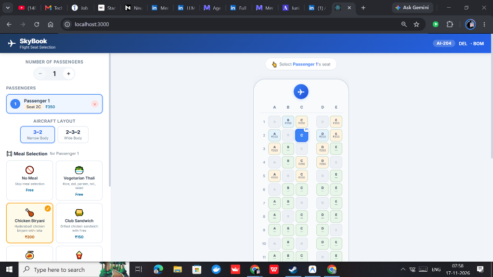
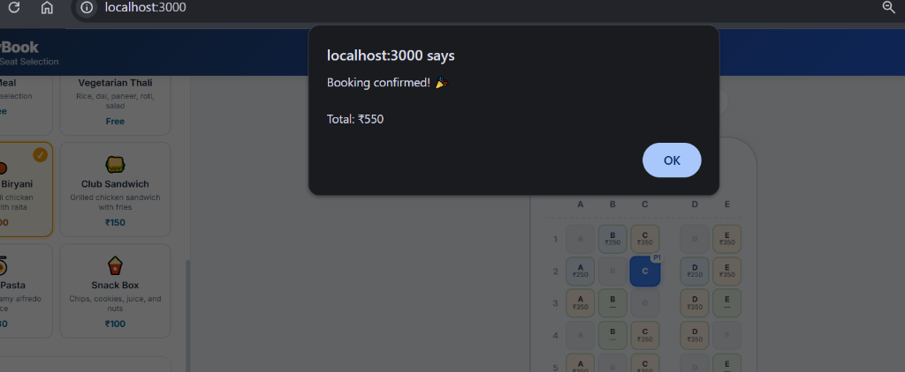

# ✈️ SkyBook — Flight Seat Selection & Passenger Management

A React.js application for selecting flight seats, managing passengers, choosing meals, and viewing pricing — built as a technical assessment.

 

---

## 🚀 Live Demo

> _Add your deployed link here (e.g., Vercel / GitHub Pages)_

---

## 📸 Screenshots

### Seat Selection & Meal Choice


### Booking Confirmation


---

## 🛠️ Setup & Run

### Prerequisites

- **Node.js** ≥ 16
- **npm** ≥ 8

### Installation

```bash
# Clone the repository
git clone https://github.com/Amaan00844/flight-seat-selection.git
cd flight-seat-selection

# Install dependencies
npm install

# Start the development server
npm start
```

The app will open at [http://localhost:3000](http://localhost:3000).

### Production Build

```bash
npm run build
```

---

## 🏗️ Project Structure

```
src/
├── components/
│   ├── PassengerSelector.jsx   # Passenger count selector (+/− controls)
│   ├── PassengerSelector.css
│   ├── PassengerList.jsx       # Passenger cards with seat assignments
│   ├── PassengerList.css
│   ├── LayoutSwitcher.jsx      # Toggle between 3–2 and 2–3–2 layouts
│   ├── LayoutSwitcher.css
│   ├── SeatMap.jsx             # Aircraft seat map with interactive seats
│   ├── SeatMap.css
│   ├── SeatLegend.jsx          # Legend for seat states and categories
│   ├── SeatLegend.css
│   ├── MealSelector.jsx        # Meal selection (bonus feature)
│   ├── MealSelector.css
│   ├── PricingSummary.jsx      # Pricing breakdown table
│   └── PricingSummary.css
├── data/
│   └── seatData.js             # Mock data: seat layouts, categories, meals
├── hooks/
│   └── useBooking.js           # Custom hook: all booking state & logic
├── App.js                      # Main app layout & component composition
├── App.css                     # Global layout & responsive styles
├── index.js                    # React entry point
└── index.css                   # Global CSS reset & scrollbar styles
```

---

## 🧠 State Management & Seat Assignment Logic

### State Management Approach

All application state is centralized in a single **custom React hook** (`useBooking`) using `useState` and `useMemo`. This provides:

- **Single source of truth** — all state lives in one place
- **Clean separation** — UI components are purely presentational
- **No external dependencies** — only React built-in hooks (no Redux, Zustand, etc.)

### Core State

| State Variable         | Type     | Purpose                                       |
| ---------------------- | -------- | --------------------------------------------- |
| `passengerCount`       | `number` | Number of passengers (1–9)                    |
| `activePassengerIndex` | `number` | Currently selected passenger                  |
| `layoutType`           | `string` | Active aircraft layout (`layout1` / `layout2`)|
| `seatAssignments`      | `object` | Map of `passengerIndex → seatId`              |
| `mealSelections`       | `object` | Map of `passengerIndex → mealId`              |

### Seat Assignment Logic

1. **Select a passenger first** — the active passenger is highlighted in the sidebar.
2. **Click an available seat** — it gets assigned to the active passenger.
3. **Click the same seat again** — it gets deselected (toggle behavior).
4. **Conflict prevention** — a seat occupied by another passenger in the group cannot be re-assigned. Pre-occupied seats (mock data) are permanently disabled.
5. **Switching passengers** — previous seat assignments are retained.
6. **Reducing passengers** — assignments for removed passengers are cleaned up automatically.
7. **Switching layouts** — all seat assignments are cleared since seats differ between configurations.

### Derived State (via `useMemo`)

- **`seatMap`** — flat lookup table `seatId → seat object` for O(1) seat queries
- **`seatToPassenger`** — reverse lookup `seatId → passengerIndex` for conflict detection
- **`passengers`** — enriched passenger array with seat info and meal selections
- **`pricing`** — calculated breakdown with seat totals, meal totals, and grand total

### Pricing Calculation

- Each seat has a category-based price (Standard = ₹0, Extra Legroom = ₹350, Premium = ₹250)
- Each meal option has a price (some free, some paid)
- The total updates **immediately** whenever a seat or meal selection changes
- Pricing is computed as a `useMemo` derived from `passengers`, ensuring it stays in sync

---

## ✨ Features

### Core Features
- ✅ Select 1–9 passengers with +/− controls
- ✅ Switch between passengers while retaining seat assignments
- ✅ Two aircraft layouts: **3–2** (narrow body) and **2–3–2** (wide body)
- ✅ Interactive seat map with row numbers and column labels
- ✅ Visual seat states: Available, Occupied, Your Seat, Other Passenger
- ✅ Color-coded seat categories: Standard (free), Extra Legroom (₹350), Premium (₹250)
- ✅ Seat assignment with conflict prevention
- ✅ Toggle/remove seat assignments
- ✅ Real-time pricing breakdown table
- ✅ Responsive layout (desktop → mobile)

### Bonus Feature
- ✅ **Meal selection** — 6 meal options per passenger (free & paid), included in total

### UI/UX
- ✅ Clean, modern design with Inter font
- ✅ Aircraft-shaped seat map with cockpit nose
- ✅ Sticky sidebar on desktop
- ✅ Hover tooltips showing seat details
- ✅ Passenger badge overlays on assigned seats (P1, P2, etc.)
- ✅ Warning when not all passengers have seats
- ✅ Confirm booking button when all seats assigned

---

## 📋 Evaluation Coverage

| Criteria                              | Implementation                                     |
| ------------------------------------- | -------------------------------------------------- |
| UI/UX and visual implementation       | Modern design, smooth transitions, color-coded      |
| Seat layout and configuration         | Both 3–2 and 2–3–2 layouts with dynamic switching  |
| Passenger and seat assignment logic   | Full CRUD with conflict prevention                  |
| Pricing and total calculations        | Real-time derived pricing with breakdown            |
| Code quality and component architecture| Reusable components, custom hook, BEM CSS           |
| Responsiveness and edge-case handling | Mobile-first responsive, all edge cases handled     |
| **Bonus: Meal selection**             | 6 options per passenger, free & paid, in total      |

---

## 🧰 Technologies

- **React 18** — UI framework
- **React Hooks** — State management (`useState`, `useMemo`, `useCallback`)
- **CSS3** — Styling with BEM methodology, CSS custom properties, responsive design
- **Create React App** — Project scaffolding

No external UI libraries or state management packages were used.

---

## 📄 License

MIT
